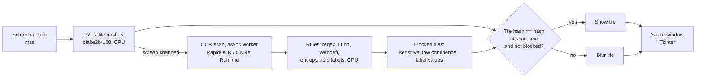

# ShareGuard: on-device screen-share privacy shield

ShareGuard sits between your screen and your video call. It shows a copy of your screen in which API keys, passwords, Aadhaar numbers, PAN, card numbers, emails and phone numbers stay blurred, and you share that window in Teams or Meet instead of your real screen. Nothing leaves the machine. `--offline` blocks all network access inside the process.

**Status (30 Sep 2026):** this is a working prototype, built and tested on Linux x86-64 (CPU). The Snapdragon NPU path (ONNX Runtime QNN, device selection, per-model probe). See [What is built vs planned](#what-is-built-vs-planned).

## Why local, and where Snapdragon fits
- **It can't run in the cloud.** A cloud OCR service would have to see the very screen you're trying to protect.
- **Speed decides usability.** Because changed regions stay blurred until they've been read, OCR speed is how long safe text takes to come back after a window switch. That burst of text reading is the part meant for the NPU. The fixed-shape EasyOCR models on Qualcomm AI Hub are the candidates (see `docs/ARCHITECTURE_REVIEW.md`). Whether the NPU actually beats the CPU here is something we'll measure, not assume.

## How it works


Four rules keep it fail-closed:
1. **Blur first.** Every frame starts fully blurred. A tile is shown only if a completed OCR scan read and cleared it.
2. **Pixel-identity check.** A tile is shown only if its 128-bit hash on the frame being displayed equals its hash in the scan that cleared it. This closes the race where text changes while a scan is still running. The composed output is re-hashed every frame and any mismatch is counted as a violation (it must stay 0).
3. **Uncertain means blurred.** OCR lines below the confidence threshold stay blurred. So does the value next to a field label ("Name:", "PAN:", `AWS_ACCESS_KEY_ID=`), even before the value is complete enough to match a pattern.
4. **OCR-tolerant rules.** Common OCR swaps (`O→0`, `l/I→1`, `S→5`, `B→8`) are undone before the Aadhaar (Verhoeff) and card (Luhn) checksums. Label matching tolerates OCR dropping underscores (`AWS ACCESS KEY ID`), a bug our own test replay caught.

## Quick start
```bash
./scripts/setup_unix.sh                          # macOS/Linux; Windows ARM64: scripts/setup_windows_arm64.ps1
python -m shareguard.app.main check              # hardware + available ONNX Runtime providers
python -m shareguard.app.main --offline demo     # scripted replay with planted secrets, scored
python -m shareguard.app.main --offline live     # redacted view of monitor 1; share this window
python -m shareguard.app.main bench              # per-stage latency -> results/*.json
python -m shareguard.app.main npu-probe m.onnx   # one ONNX model on npu / gpu / cpu (Windows ARM64)
python -m pytest -q                              # 12 tests
```
On macOS, `live` needs the Screen Recording permission for your terminal.

## Measured results (Linux x86-64 box, CPU only, not Snapdragon)
These come from the JSON files in `results/`, produced by the commands above. They show that the pipeline works; they are not performance claims for any Snapdragon device.

| Metric | Value | Command |
|---|---|---|
| Planted secrets missed in scripted replay (Aadhaar, PAN, card, name, AWS key typed char-by-char) | 0 of 5, in 2 of 2 runs | `demo` |
| Pixel-identity violations | 0 | `demo` |
| OCR per full 1280×800 scan, p50 | 223–241 ms | `demo` |
| Time until 90% of safe text is readable after a window switch, p50 | 0.4 s | `demo` (real-time, 10 fps) |
| Tile hashing / rules / blur per frame, p50 | ~6 / 0.1 / ~8 ms | `bench` |
| OCR model load | 264 ms | `bench` |

Five secrets is a smoke test, not a safety claim. The statistically sized evaluation (thousands of synthetic secrets, split by template, with a Clopper–Pearson bound via `shareguard/benchmarking/calibrate.py`) is described in `docs/ARCHITECTURE_REVIEW.md`.

**To fill in on Snapdragon hardware** (template in `docs/BENCHMARKS.md`): the same table for NPU, GPU and CPU, plus AI Hub profile numbers for the EasyOCR models (`scripts/aihub_profile.md`).

## What is built vs planned
| Built and tested (CPU) | Written, untested on Snapdragon | Planned |
|---|---|---|
| Fail-closed tile pipeline, async OCR, pixel-identity check | QNN session factory (`backend_path` QnnHtp/QnnGpu, `htp_performance_mode`, EP context cache, no silent CPU fallback) | EasyOCR (AI Hub, fixed shape) as the NPU OCR engine |
| Rules: Aadhaar, PAN, card, AWS/API keys, email, phone, entropy, field labels | `npu-probe` per-model benchmark | Windows Graphics Capture (zero-copy) |
| Synthetic replay + scoring, benchmark harness, Learn-then-Test calibration | Windows ARM64 setup script | Line cache + scroll compensation, line packing |
| Offline mode, logging, CLI, Tkinter share window (tested headless only) | | Retrained recogniser, virtual camera, face blur |

## Models and licences
| Component | Source | Licence | Runs on (verified) |
|---|---|---|---|
| OCR (tonight) | RapidOCR (`rapidocr_onnxruntime`, PP-OCR models) | Apache-2.0 | CPU via ONNX Runtime |
| OCR (NPU target) | EasyOCR detector + recogniser, Qualcomm AI Hub | Apache-2.0 | not yet measured |
| Rules | this repo | Apache-2.0 | CPU |

The demo fonts are DejaVu Sans Mono (Bitstream Vera licence), or any SIL OFL font via `SHAREGUARD_FONT`. All secrets are synthetic and fake. No real or confidential data is included.

## Limitations
- There are no Snapdragon measurements yet (the author doesn't own a Snapdragon PC). Every NPU statement is a plan until `npu-probe` or AI Hub numbers are added.
- `mss` capture is CPU-copy based. The share window can capture itself if it sits on the captured monitor, so use `--region` or a second display.
- The OCR confidence threshold (0.80) is a default, not yet calibrated with `calibrate.py`.
